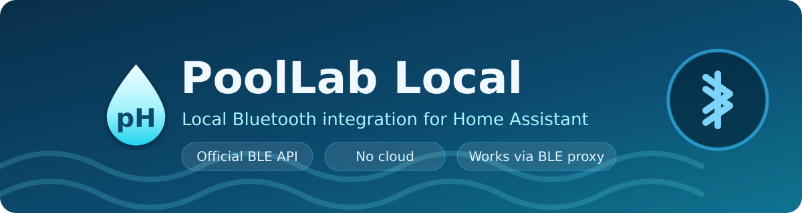

<p align="center">
  
</p>

<p align="center">
  
  
  
  
</p>

Reads the **PoolLab 1.0** water tester by Water-i.d. directly over Bluetooth LE and
exposes every measured parameter as a sensor in Home Assistant. No cloud, no account,
no app that has to sync first.

> [!NOTE]
> Fork of [mf76130/ha-poollab-local](https://github.com/mf76130/ha-poollab-local) v0.4.1,
> with bug fixes, measurement timestamps, clock synchronisation, offline parser tests and
> full device control. See [CHANGELOG.md](CHANGELOG.md) for everything that changed.

---

## Why local?

The existing PoolLab integrations for Home Assistant —
[dala318/python_poollab](https://github.com/dala318/python_poollab) and
[stefanh12/Poollab](https://github.com/stefanh12/Poollab) — fetch their data from
`labcom.cloud`. That means syncing with the LabCOM app before Home Assistant sees
anything, and your readings leave your house.

This integration talks to the device directly. The manufacturer
[publishes the protocol itself](https://poollab.org/static/api/BLE.pdf) (Water-i.d. GmbH,
version 2), so no reverse engineering is involved.

| | Cloud integrations | **PoolLab Local** |
|---|---|---|
| Connection | Internet → labcom.cloud | Bluetooth LE, direct |
| Account required | Yes, with an API token | No |
| App sync first | Yes | No |
| Works without internet | No | Yes |
| Readings leave your home | Yes | No |

---

## Requirements

- Home Assistant **2024.6** or newer with the Bluetooth integration enabled
- Bluetooth reception within range of the device: an adapter in the Home Assistant host,
  or an **ESPHome Bluetooth proxy**. That proxy must allow active connections:

  ```yaml
  esp32_ble_tracker:
    scan_parameters:
      active: true
  bluetooth_proxy:
    active: true      # required — passive listening is not enough
  ```

  The protocol is a command/response exchange, so a real GATT connection is needed.

---

## Installation

### Via HACS (recommended)

1. HACS → three-dot menu → **Custom repositories**
2. Repository `https://github.com/mhoogenbosch/ha-poollab-local`, category **Integration**
3. Search for **PoolLab Local** and click **Download**
4. **Restart Home Assistant** (required for new integrations)
5. Switch the PoolLab on within range of a proxy → it shows up under
   **Settings → Devices & Services** as a discovered device. Confirming is all it takes;
   there is nothing to fill in.

If it does not appear on its own, use **Add integration → PoolLab Local** and pick the
device from the list.

### Manual

Copy `custom_components/poollab_local` into the `custom_components` folder of your Home
Assistant configuration and restart.

---

## Usage

The PoolLab powers itself off after roughly **300 seconds** and accepts only **one BLE
connection at a time**. So the workflow is:

1. Take your measurement on the device as usual
2. Press **Fetch now** in Home Assistant within that window
3. A sensor appears for each measured parameter, holding the latest value

There is deliberately **no background polling**. It would only generate Bluetooth traffic
for a device that is switched on a few times a week, and clash with the LabCOM app. If you
want it anyway, set `UPDATE_INTERVAL_SECONDS` in `const.py` to a number of seconds.

### Entities

| Entity | Type | Description |
|---|---|---|
| `button.poollab_fetch_now` | button | Connect now and pull the stored measurements |
| `button.poollab_set_clock` | button | Sync the device clock with Home Assistant |
| `button.poollab_sleep` | button | Put the device into deep sleep (saves battery) |
| `button.poollab_restart` | button | Restart the device |
| `button.poollab_contrast_up` / `_down` | button | LCD contrast one step (range 18–38) |
| `button.poollab_erase_memory` | button | Wipe all measurements — **disabled by default**, irreversible |
| `select.poollab_unit` | select | Device display in ppm or mg/L |
| `sensor.poollab_<parameter>` | sensor | One per measured parameter (pH, free chlorine, …) |
| `sensor.poollab_combined_chlorine` | sensor | Chloramines, derived as total − free chlorine |
| `sensor.poollab_last_measurement` | sensor | Timestamp of the most recent measurement |
| `binary_sensor.poollab_reachable` | diagnostic | Does Home Assistant see the device right now? |
| `sensor.poollab_via_proxy` | diagnostic | Which adapter or Bluetooth proxy hears the device |
| `sensor.poollab_signal_strength` | diagnostic | RSSI of the last advertisement, in dBm |
| `sensor.poollab_stored_measurements` | diagnostic | Measurements held in device memory (max 256) |
| `sensor.poollab_clock_drift` | diagnostic | Device clock versus Home Assistant, in seconds |
| `sensor.poollab_battery` | diagnostic | Battery level in percent |
| `sensor.poollab_lcd_contrast` | diagnostic | Last known contrast level — **disabled by default** |

Measurement sensors are created the first time that parameter is measured and persist
afterwards. Values survive a Home Assistant restart.

### Knowing whether the device is reachable

The PoolLab is switched off most of the time, so a failed read is usually not a fault.
**`binary_sensor.poollab_reachable`** shows live whether Home Assistant hears the device
advertising — handy for deciding whether pressing **Fetch now** is worth it. Its attributes
tell the rest: `received_via` (which adapter or proxy), `rssi`, and `last_read_successful`.

`sensor.poollab_signal_strength` exposes that RSSI as its own value, and
`sensor.poollab_via_proxy` names the adapter. In a multi-proxy setup that changes over
time: if reads keep going over a weak route, a proxy closer to the pool is the fix. Signal
strength is cleared once the device is out of range; the proxy name is kept, because
knowing where it was last heard stays useful.

`sensor.poollab_clock_drift` shows how far the device clock has wandered. The device
timestamps its own measurements, so when this grows, press **Set clock**.

### Attributes on each measurement sensor

| Attribute | Meaning |
|---|---|
| `measured_at` | When the measurement was taken on the device |
| `status` | `ok`, `under_range` or `over_range`, as reported by the device |
| `measure_id` | Sequence number of the measurement on the device |
| `ideal_low` / `ideal_high` | Your target range for this parameter |
| `ideal_range_status` | `low`, `ok` or `high` |
| `skipped_reading` | A more recent reading was not used as the value |
| `skipped_reading_at` | When that skipped reading was taken |
| `value_is_minimum` | The value is the top of the measuring range; the real value is at least this |
| `range_min` / `range_max` | What the device can measure for this parameter |

The measuring range comes from the official documentation and explains why a reading falls
outside it: pH, for instance, is only measured between **6.50 and 8.40**, so a failed pH
test inevitably lands below range.

### Combined chlorine

Free and total chlorine are measured; **combined chlorine** — the chloramines that cause
the "chlorine smell" and stinging eyes — is derived as total minus free. That is the value
telling you whether the pool needs shocking (target: below 0.5 ppm).

The sensor stays empty when subtracting would be meaningless: only one of the two measured,
readings more than 15 minutes apart, or either one out of range. It reports
`reason_unavailable` when it declines. See **[docs/CHLORINE_CHEMISTRY.md](docs/CHLORINE_CHEMISTRY.md)**
for what the numbers mean and how chlorine interacts with pH and stabiliser.

### Out-of-range readings

The device reports value `0.0` for **both** underrange and overrange — the reading simply
did not fit its scale, so that number means nothing. Taking it at face value is actively
wrong: a total alkalinity above 200 ppm would show as `0.0` and be judged "low", the exact
opposite of reality.

- **Underrange** (e.g. measuring without a reagent tablet) is skipped; the last valid
  reading stays, and `skipped_reading` records what happened.
- **Overrange** is clamped to the top of the measuring range and flagged with
  `value_is_minimum`, so it reads as "at least this" and is correctly judged `high`.

To get the real number, dilute: 5 ml sample plus 5 ml distilled water, measure again and
multiply by 2. Dilution does not work for pH.

### Measurement order

Each parameter needs its **own fresh 10 ml sample and its own ZERO** (taken without
reagent) before the tablet goes in. The one exception is **total chlorine, which is
measured straight after free chlorine without emptying the cuvette** — the DPD 3 tablet
joins the already dissolved DPD 1, and combined chlorine is total minus free. Note that
free chlorine must be read **within one minute** of the tablet dissolving, or the values
drift upward.

### Adjusting target ranges

`IDEAL_RANGES` in `const.py` drives the `ideal_*` attributes. The defaults are common
guidance figures for a private chlorine outdoor pool:

```python
IDEAL_RANGES = {
    1:  (1.0, 3.0),      # Total chlorine (ppm)
    6:  (2.0, 4.0),      # Bromine (ppm)
    8:  (1.0, 3.0),      # Free chlorine (ppm)
    9:  (7.0, 7.4),      # pH
    10: (80.0, 120.0),   # Total alkalinity (ppm)
    11: (30.0, 50.0),    # Cyanuric acid (ppm)
    35: (200.0, 400.0),  # Total hardness (ppm)
}
```

These are not part of the BLE protocol; adapt them to your pool (salt water, bromine, spa).

### Automation examples

Alert when pH leaves the target range, filtering out failed measurements:

```yaml
automation:
  - alias: "Pool - pH out of range"
    triggers:
      - trigger: state
        entity_id: sensor.poollab_ph
    conditions:
      - condition: template
        value_template: "{{ state_attr('sensor.poollab_ph', 'status') == 'ok' }}"
      - condition: template
        value_template: >
          {{ state_attr('sensor.poollab_ph', 'ideal_range_status') != 'ok' }}
    actions:
      - action: notify.mobile_app_phone
        data:
          title: "Pool pH"
          message: >
            pH is {{ states('sensor.poollab_ph') }}
            ({{ state_attr('sensor.poollab_ph', 'ideal_range_status') }}).
```

Remind yourself when no test has been done for a week:

```yaml
automation:
  - alias: "Pool - no water test for a week"
    triggers:
      - trigger: template
        value_template: >
          {{ now() - states('sensor.poollab_last_measurement') | as_datetime
             > timedelta(days=7) }}
    actions:
      - action: notify.mobile_app_phone
        data:
          message: "No pool water test for a week."
```

---

## Saving battery

After a read the device stays on for another ~300 seconds before switching itself off.
Press **Sleep** and it goes into deep sleep immediately — under 20 µA, typically 8.5 µA.
That is the same state as holding the power button, and the internal clock keeps running.

---

## Troubleshooting

Enable verbose logging first:

```yaml
logger:
  logs:
    custom_components.poollab_local: debug
```

Check `binary_sensor.poollab_reachable` before anything else: if it is off, Home Assistant
simply cannot see the device and reading is pointless.

| Symptom | Cause and fix |
|---|---|
| `was not seen by any Bluetooth adapter/proxy` | The device is off or out of range. Switch it on; it powers down again after ~300 s. In the debug log this shows as a read failing in **0.000 seconds** — no Bluetooth activity happened at all. |
| `Timed out talking to PoolLab` | The connection succeeded but the device did not answer — a read of roughly **21 seconds** in the log. Usually the **LabCOM app** holds the only BLE connection, or the device sits in a measurement screen or menu. Close the app, return to the home screen and retry. |
| No measurement sensors, only battery | Device memory is empty. Take a measurement and press **Fetch now**. |
| A value of `0.0` | Check `status`: `under_range` means the measurement itself was invalid (no reagent tablet). |
| `measured_at` is wrong | The device clock has drifted. Press **Set clock**. |

---

## How it works

The device exposes its own GATT service (`PoolLabSvc`,
`A7EE04A9-507B-4910-A528-B619D5501924`) with three characteristics:

| Characteristic | UUID | Role |
|---|---|---|
| `CommandMOSI` | `91BFA536-…` | write command (≤128 bytes) |
| `CommandMISO` | `2FF18B59-…` | read response (always 250 bytes) |
| `MISO_Signal` | `C2296C06-…` | notify: "response ready" |

One exchange goes like this: connect without pairing, enable notifications on
`MISO_Signal`, write the command to `CommandMOSI` (preamble `0xAB` + 16-bit command ID +
parameters), wait for the notification, then read the answer from `CommandMISO`. All
multi-byte values are little-endian.

The integration sends `GET_INFO` (battery, stored measurement count, clock) and then
`GET_MEASURES` across the flash cells. Memory holds 16 cells of 16 measurements, read half
(8) at a time; each record is 16 bytes carrying a sequence number, parameter type, status,
timestamp and an IEEE-754 float.

Every command in the API is exposed. Note that `RESET_DEVICE` and `SLEEP_DEVICE` produce
**no response** — the device kills its radio immediately — so they bypass the normal
command routine that waits for a notification.

---

## Tests

```bash
python3 tests/test_parsers.py
```

Builds synthetic `GET_INFO` and `GET_MEASURES` frames byte by byte per the specification
and checks the parser decodes them correctly, including edge cases such as an implausible
device clock, non-finite values and out-of-range readings. Runs without hardware and
without Home Assistant.

---

## Limitations

- The LabCOM app cannot connect while Home Assistant is reading.
- **Firmware cannot be updated over Bluetooth.** The API has no command for it; that goes
  exclusively through the LabCOM app, which uses a separate bootloader.

---

## License and credits

See [LICENSE](LICENSE). Thanks to
[mf76130](https://github.com/mf76130/ha-poollab-local) for the original work, and to
[kenavn](https://github.com/kenavn/esphome-poollab) for a readable transcription of the
protocol documentation.
